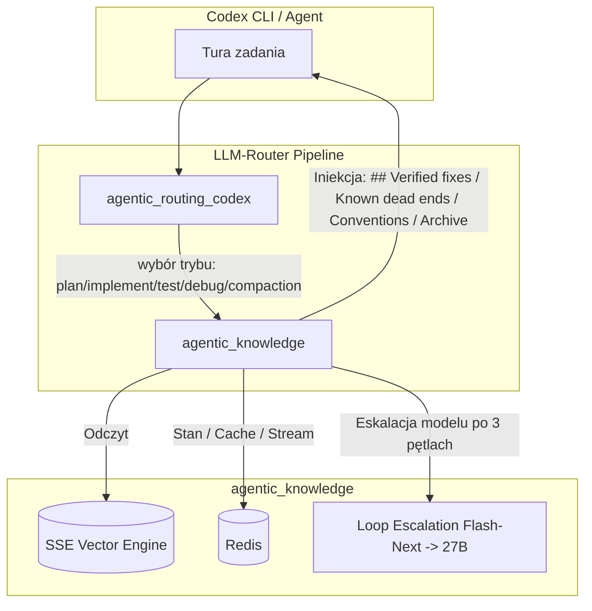
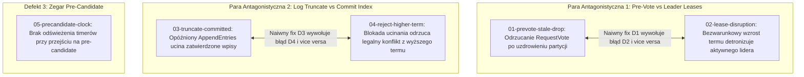
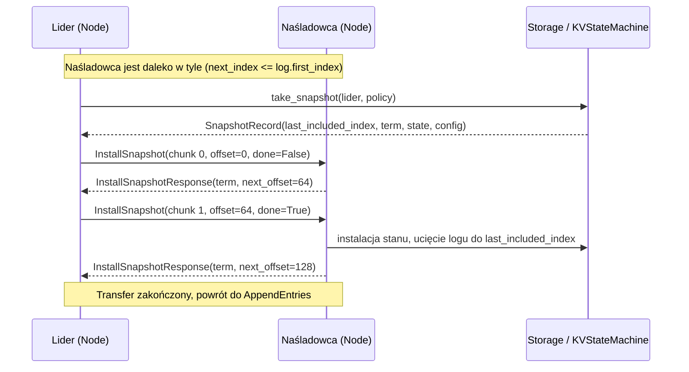

# Plan implementacji zadań Memory Suite dla AK-Bench (`tidewater`)

> **Cel:** Przygotowanie dwóch ekstremalnie trudnych zadań poziomu `expert` dla silnika `tidewater` (deterministyczny symulator konsensusu Raft):
> 1. `bug_fix`: **`tidewater-election-001`** (5 sprzężonych defektów w logice elekcji, dzierżawy lidera i replikacji logu; 2 pary antagonistyczne)
> 2. `new_feature`: **`tidewater-snapshot-001`** (Implementacja kompaktowania logu, strumieniowania `InstallSnapshot` oraz procedury regeneracji śladów)
> 
> Zadania są zaprojektowane w taki sposób, aby mały model bez pamięci (`qwen/Qwen3.8-Flash-Next` bez pluginów) nie był w stanie ich rozwiązać, a pełna konfiguracja z pluginami `auto_codex` (`agentic_routing_codex`) oraz `agentic_knowledge` z `../llm-router-plugins/` wielokrotnie wykorzystywała mechanizmy: **bazy wiedzy (recipes)**, **zapisu niepowodzeń (dead ends)**, **procedur (playbooks)**, **wyszukiwania dokumentacji (doc map / doc context)**, **kompaktowania sesji (session archive)** oraz **eskalacji pętli błędów (knowledge-or-escalate)**.

---

## 1. Architektura integracji z `llm-router-plugins`

Zadania bezpośrednio angażują specyficzne właściwości pluginów z `../llm-router-plugins/`:



### Mapowanie mechanizmów na zachowanie modelu

1. **Tryby pracy (`agentic_routing_codex`):**
   - `<collaboration_mode> Plan` $\rightarrow$ model `qwen/Qwen3.8-Flash-Next` do analizy specyfikacji i mapy dokumentacji.
   - Standardowa edycja (`implement`) $\rightarrow$ `Flash-Next`.
   - Uruchomienie testów/CLI (`test`) $\rightarrow$ przełączenie na `qwen/Qwen3.8-27B`.
   - Analiza błędu (`debug`) $\rightarrow$ `Flash-Next` (lub model po eskalacji).
   - Długie ślady symulacji (`compaction`) $\rightarrow$ `27B` kompresujący kontekst, z jednoczesnym zapisem pełnego okna do `session_archive`.

2. **Antagonistyczne pętle błędów i eskalacja (`knowledge-or-escalate`):**
   - Dwie pary defektów w `bug_fix` mają identyczny podpis wyjątku `SafetyViolation: election_safety` oraz `SafetyViolation: leader_completeness`.
   - Naiwna naprawa defektu A powoduje powrót defektu B. Mały bezstanowy model próbuje lokalnych patchy i zapętla się.
   - Po 3 powtórzeniach tego samego podpisu (`signature_hash`), plugin `agentic_knowledge` odnotowuje `deadend` i eskaluje model na `qwen/Qwen3.8-27B` (`reason: loop_without_recipe`).

3. **Pamięć z bazy wiedzy (Recipes & Deadends):**
   - Udana naprawa podproblemu 1 generuje wpis `recipe` pod nagłówkiem `## Verified fixes in this repo`.
   - Gdy agent przechodzi do podproblemu 2, obecność recepty uniemożliwia wycofanie naprawionego niezmiennika (ochrona przed regresją).
   - Nieudane próby są zapisywane jako `deadend` pod nagłówkiem `## Known dead ends (do not repeat)`.

4. **Procedury i dług techniczny (Playbooks):**
   - W zadaniu `new_feature`, po wdrożeniu kodu, testy ukryte wymagają uruchomienia narzędzia `tools/reference_traces.py` w celu regeneracji skrótów `traces/*.digest` i zablokowania `schedules/MANIFEST`.
   - Procedura ta jest opisana w `docs/runbooks/regenerate-traces.md`. Udane wykonanie przez agenta uczy plugin `playbooka`, który trafia do bazy wiedzy pod `## Verified procedures in this repo`.

5. **Hierarchia dokumentacji i mapa kontekstu (`doc_context`):**
   - Repozytorium `tidewater` zawiera: `SPEC.md`, `README.md`, `CONTRIBUTING.md`, 12 ADR-ów w `docs/adr/`, 8 postmortemów w `docs/incidents/INC-*.md`, runbooki w `docs/runbooks/` oraz `docs/glossary.md`.
   - `README.md` zawiera celowo uproszczone reguły (lub lekko zdezaktualizowane). Prawda o zachowaniu dzierżawy lidera i pre-vote znajduje się wyłącznie w `docs/adr/ADR-0005` oraz `docs/incidents/INC-0004` i `INC-0008`.
   - Plugin wstrzykuje mapę nagłówków dokumentacji (`docs.context_enabled=true`) oraz fragmenty relewantnych ADR-ów powiązanych ze zmienianymi modułami (`src/tidewater/node.py` $\rightarrow$ `docs/adr/ADR-0005`).

6. **Archiwum sesji przed kompaktowaniem (`session_archive`):**
   - Symulator generuje obszerne ślady JSONL (nawet 3000 ticków, setki zdarzeń). Wieloetapowe rozwiązywanie zadania przekracza okno i uruchamia żądanie `compaction`.
   - `session_archive` zapisuje zrzut okna do bazy i odzyskuje w kolejnej turze jako `## Exact context from before compaction`, dzięki czemu agent nie traci numeru seeda, sygnatury pierwszego ticku dywergencji ani identyfikatora węzła.

---

## 2. Zadanie 1: `bug_fix` — `tidewater-election-001`

### 2.1 Metadane zadania
* **Katalog:** `datasets/bug_fix/tidewater-election-001/`
* **ID:** `tidewater-election-001`
* **Kategoria:** `bug_fix`
* **Poziom trudności:** `expert`
* **Limit czasu:** 10800 sekund (3h)
* **Ziarno:** `datasets/_sources/tidewater` (standard library only, Python 3.12)
* **Ewaluator:** `pytest_evaluator`

### 2.2 Zestaw 5 defektów (mutacje w `src/tidewater/node.py` i `src/tidewater/log.py`)

Zadanie zawiera 5 niezależnych mutacji, w tym dwie pary antagonistyczne:



#### Szczegóły techniczne defektów:
1. **Część 1 (`parts/01-prevote-stale-drop.patch`):**
   * *Plik:* `src/tidewater/node.py` w `_handle_request_vote`
   * *Błąd:* Węzeł ignoruje pre-vote od kandydata, którego `term == self.current_term`, gdy `options.pre_vote=True`, uznając go za "stale", co w scenariuszu uzdrowienia symetrycznej partycji uniemożliwia wybór lidera (`ElectionTimeoutViolation` / zawieszenie klastra).
   * *Świadek (witness):* `test_prevote_healed_partition_converges`
2. **Część 2 (`parts/02-lease-disruption.patch`):**
   * *Plik:* `src/tidewater/node.py` w `_handle_request_vote`
   * *Błąd:* Bezwarunkowe przyjęcie termu kandydata bez weryfikacji dzierżawy lidera (`leader_stickiness`, `ADR-0005`, `INC-0007`). Węzeł, który niedawno otrzymał heartbeat od lidera, powinien odrzucić pre-vote/vote. Brak tego warunku powoduje detronizację działającego lidera (`SafetyViolation: election_safety`).
   * *Świadek (witness):* `test_lease_protects_active_leader`
3. **Część 3 (`parts/03-truncate-committed.patch`):**
   * *Plik:* `src/tidewater/log.py` w `truncate_from`
   * *Błąd:* Ucinanie logu pozwala na usunięcie wpisów o indeksie $\le \text{commit\_index}$, gdy opóźniony pakiet `AppendEntries` z poprzedniej kadencji dotrze po restarcie węzła. Prowadzi do `SafetyViolation: leader_completeness`.
   * *Świadek (witness):* `test_restart_preserves_committed_entries`
4. **Część 4 (`parts/04-reject-higher-term.patch`):**
   * *Plik:* `src/tidewater/node.py` w `_handle_append_entries`
   * *Błąd:* Błędna weryfikacja konfliktu: węzeł odrzuca `AppendEntries` zamiast uciąć niezatwierdzony ogon logu, jeśli wpis pochodzi z wyższego termu, blokując replikację (`SafetyViolation: log_matching`).
   * *Świadek (witness):* `test_higher_term_truncates_uncommitted`
5. **Część 5 (`parts/05-precandidate-clock.patch`):**
   * *Plik:* `src/tidewater/node.py` w `_on_election_timeout`
   * *Błąd:* Przejście w stan `PRE_CANDIDATE` nie resetuje losowego timeoutu wyborczego z własnego strumienia RNG (`ADR-0002`). Powoduje to natychmiastowe kolejne wywołanie timeoutu w następnym ticku i szturm wyborczy (`SafetyViolation: election_safety`).
   * *Świadek (witness):* `test_precandidate_clock_skew_resets_timer`

### 2.3 Struktura katalogu zadania
```
datasets/bug_fix/tidewater-election-001/
├── task.yaml
├── description.md
├── public_tests/
│   └── test_election_public.py
├── hidden_tests/
│   ├── test_election_hidden.py
│   └── schedules/
│       ├── test_prevote_partition.json
│       ├── test_lease_protection.json
│       └── test_delayed_append.json
└── mutations/
    ├── mutation-001.patch
    ├── parts.json
    └── parts/
        ├── 01-prevote-stale-drop.patch
        ├── 02-lease-disruption.patch
        ├── 03-truncate-committed.patch
        ├── 04-reject-higher-term.patch
        └── 05-precandidate-clock.patch
```

### 2.4 Treść `task.yaml` i `description.md`
* `task.yaml`: Standardowy schemat ak-bench (`schema_version: "1.0"`, `difficulty: expert`, `evaluator: pytest_evaluator`).
* `description.md`: Opis w języku angielskim zgodny z konwencją ak-bench:
  - Wskazuje na objawy w klastrze produkcyjnym: zawieszanie się elekcji po powrocie sieci, detronizacja zdrowego lidera, utrata zatwierdzonych wpisów po restarcie węzła.
  - Odwołuje się do hierarchii prawdy: `docs/adr/` > `SPEC.md` > `README.md`.
  - Przypomina o zakazie edycji testów bazowych i zakazie usuwania mechanizmów bezpieczeństwa.
  - Nie zdradza nazw patchy ani konkretnych linii kodu.

---

## 3. Zadanie 2: `new_feature` — `tidewater-snapshot-001`

### 3.1 Metadane zadania
* **Katalog:** `datasets/new_feature/tidewater-snapshot-001/`
* **ID:** `tidewater-snapshot-001`
* **Kategoria:** `new_feature`
* **Poziom trudności:** `expert`
* **Limit czasu:** 10800 sekund (3h)
* **Ziarno:** `datasets/_sources/tidewater`
* **Ewaluator:** `pytest_evaluator`

### 3.2 Zakres implementacji (`tidewater.snapshot` i moduły towarzyszące)

W repozytorium bazowym `tidewater` moduł `snapshot.py` to zbiór stubów rzucających `FeatureNotImplemented`. Wdrożenie wymaga zaimplementowania pełnego kontraktu z `SPEC.md` sekcja 6 oraz `ADR-0006` i `ADR-0011`.



#### Główne komponenty do wdrożenia:
1. **Kompaktowanie logu (`src/tidewater/log.py`):**
   * Metoda `RaftLog.compact_to(last_included_index, last_included_term)`:
     - Usunięcie prefiksu logu do `last_included_index`.
     - Zachowanie `boundary_term` (`last_included_term`) w logu, tak aby `term_at(last_included_index)` oraz weryfikacja `prev_log_index == last_included_index` w `AppendEntries` działały bez błędów (`ADR-0006`).
     - Dostosowanie kalkulacji offsetów we wszystkich metodach logu (`entry_at`, `slice_from`, `first_index`, `last_index`).
2. **Wykonanie migawki lokalnej (`src/tidewater/snapshot.py`):**
   * `take_snapshot(node, policy)`:
     - Sprawdzenie warunku: `len(node.log) >= policy.threshold` oraz `node.last_applied > node.log.first_index`.
     - Zrzut maszyny stanowej `KVStateMachine.export_state()`.
     - Utworzenie `SnapshotRecord(last_included_index, last_included_term, state, config)`.
     - Zapis i trwały sync w `storage.save_snapshot(record)` **przed** ucięciem logu (`SPEC.md` 6.2).
     - Wywołanie `node.log.compact_to(...)`.
3. **Strumieniowanie `InstallSnapshot` (`src/tidewater/snapshot.py` & `src/tidewater/node.py`):**
   * `send_snapshot_chunk(node, peer, offset)`:
     - Pobranie rekordu z `storage.snapshot`.
     - Podział danych stanu na porcje o rozmiarze `policy.chunk_size`.
     - Emisja komunikatu `InstallSnapshot(term, leader_id, last_included_index, last_included_term, offset, data, done)`.
   * `on_snapshot_ack(node, peer, response)`:
     - Obsługa odpowiedzi `InstallSnapshotResponse`.
     - Wznawianie od `response.next_offset` zgłoszonego przez węzeł docelowy (`SPEC.md` 6.5, `ADR-0011`).
     - Po osiągnięciu `done`: aktualizacja `node.match_index[peer]` oraz `node.next_index[peer] = last_included_index + 1`.
4. **Instalacja po stronie odbiorcy (`_handle_install_snapshot` w `node.py`):**
   * Walidacja kadencji: jeśli `msg.term < self.current_term`, odrzucenie z aktualnym termem.
   * Buforowanie chunków: jeśli `msg.offset != self._snapshot_rx_offset`, żądanie oczekiwanego offsetu.
   * Po odebraniu ostatniego chunka (`msg.done`):
     - Zastąpienie stanu w `KVStateMachine.import_state(data)`.
     - Jeśli log zawiera wpis na pozycji `last_included_index` z identycznym termem, zachowanie ogona logu (`suffix`); w przeciwnym razie całkowite wyczyszczenie logu.
     - Aktualizacja `self.commit_index = max(self.commit_index, last_included_index)` oraz `self.last_applied = last_included_index`.
     - Zapis rekordu do `storage.save_snapshot(...)`.
5. **Obsługa restartów i awarii:**
   * Restart węzła podczas trwającego transferu unieważnia niezakończony bufor i wymusza rozpoczęcie od `offset=0`.
   * `resume_after_restart(node)`: odtworzenie `last_applied` i stanu maszyny z trwałego `SnapshotRecord`.

### 3.3 Dług proceduralny (Wymuszony Playbook)
Sama implementacja kodu w `src/tidewater/` nie wystarczy do przejścia testów ukrytych:
* Zgodnie z `docs/runbooks/regenerate-traces.md`, dodanie obsługi zdarzeń snapshotowych zmienia ślady referencyjne w `traces/*.digest` dla harmonogramów z włączoną kompakcją.
* Testy ukryte weryfikują integralność digestów komendą:
  ```bash
  python tools/reference_traces.py --check
  python tools/gen_schedules.py --check
  ```
* Agent musi wykonać procedurę opisaną w runbooku:
  ```bash
  python tools/reference_traces.py
  python tools/reference_traces.py --check
  ```
* Ta operacja (zakończona sukcesem testów) zostaje zarejestrowana przez `agentic_knowledge` jako `playbook` i może być ponownie wykorzystana przy kolejnych zadaniach.

### 3.4 Struktura katalogu zadania
```
datasets/new_feature/tidewater-snapshot-001/
├── task.yaml
├── description.md
├── public_tests/
│   └── test_snapshot_public.py
└── hidden_tests/
    ├── test_snapshot_hidden.py
    └── fixtures/
        └── snapshot_schedules.json
```
Rozwiązanie referencyjne (do testów integralności benchmarku) zostanie umieszczone w:
`tests/fixtures/tidewater_snapshot_solution/` (poza seedem repozytorium!).

---

## 4. Zadania bliźniacze transferu wiedzy (Scenariusze Replay & Transfer)

Zgodnie z koncepcją `configs/experiments/knowledge-replay-memory-suite.yaml`, rodzina `tidewater` powinna posiadać zestaw zadań bliźniaczych:

| ID Zadania | Typ | Rola w eksperymencie | Mechanizm transferu |
| :--- | :--- | :--- | :--- |
| `tidewater-election-001` | `bug_fix` | **learning** | Uczy bazy: 5 recept (`recipe`), dead-endy pętli, eskalacja. |
| `tidewater-election-002` | `bug_fix` | **related_transfer** | Defekt w replikacji logu (`AppendEntries` round-trip) o tej samej sygnaturze błędu; model musi zaaplikować zasadę z recepty, a nie dosłowny diff. |
| `tidewater-election-003` | `bug_fix` | **negative_transfer** | Identyczny wyjątek `SafetyViolation: election_safety`, ale wywołany celowo przez inną przyczynę (np. błędna konfiguracja kworum w `membership.py`); bezpośrednie wklejenie recepty z 001 prowadzi do pułapki (testy ukryte to wykrywają). |
| `tidewater-snapshot-001` | `new_feature` | **learning** | Wdrożenie snapshotów + procedura `tools/reference_traces.py`. Uczy `playbooka`. |
| `tidewater-snapshot-002` | `new_feature` | **related_transfer** | Rozszerzenie polityki snapshotów o selektywne odrzucanie starych chunków; wymaga powtórzenia procedury z playbooka dla innego harmonogramu. |

---

## 5. Konfiguracja eksperymentu pamięciowego

Zaprojektowany eksperyment zostanie zapisany jako:
`configs/experiments/knowledge-replay-tidewater.yaml` (oraz uwzględniony w głównym `knowledge-replay-memory-suite.yaml`).

### 5.1 Matryca 7 konfiguracji (Arms)

Eksperyment porównuje 7 ramion, precyzyjnie izolując wpływ każdego mechanizmu:

```yaml
factors:
  strategy: custom_matrix
  dimensions:
    - id: model
      values: [ qwen/Qwen3.8-27B, qwen/Qwen3.8-Flash-Next, auto_codex ]
    - id: knowledge_enabled
    - id: knowledge_escalation_enabled
  baseline:
    model: qwen/Qwen3.8-27B
    knowledge_enabled: false
    knowledge_escalation_enabled: false
  combinations:
    # 1. BASELINE: Duży model (27B) na sztywno, bez pamięci
    - model: qwen/Qwen3.8-27B
      knowledge_enabled: false
      knowledge_escalation_enabled: false

    # 2. WEAK CONTROL: Mały model (Flash-Next) na sztywno, bez pamięci
    - model: qwen/Qwen3.8-Flash-Next
      knowledge_enabled: false
      knowledge_escalation_enabled: false

    # 3. ROUTING CONTROL: auto_codex bez pamięci wiedzy
    - model: auto_codex
      knowledge_enabled: false
      knowledge_escalation_enabled: false
      runtime_env:
        LLM_ROUTER_UTILS_PLUGINS_PIPELINE: agentic_routing_codex
        LLM_ROUTER_ROUTING_SEMANTIC_AGENTIC_CODEX_MEMORY_ENABLED: "false"

    # 4. LARGE + MEMORY: 27B z warstwą wiedzy (bez eskalacji bo model jest pinned)
    - model: qwen/Qwen3.8-27B
      knowledge_enabled: true
      knowledge_escalation_enabled: false
      runtime_env:
        LLM_ROUTER_UTILS_PLUGINS_PIPELINE: agentic_knowledge
        LLM_ROUTER_KNOWLEDGE_AGENTIC_ARCHIVE_ENABLED: "true"
        LLM_ROUTER_KNOWLEDGE_AGENTIC_DOCS_ENABLED: "true"
        LLM_ROUTER_KNOWLEDGE_AGENTIC_DOCS_AUTO_INDEX: "true"
        LLM_ROUTER_KNOWLEDGE_AGENTIC_DOCS_CONTEXT_ENABLED: "true"
        LLM_ROUTER_KNOWLEDGE_AGENTIC_DOCS_MAX_FILES: "600"
        LLM_ROUTER_KNOWLEDGE_AGENTIC_LOOP_THRESHOLD: "3"

    # 5. SMALL + MEMORY: Flash-Next z warstwą wiedzy, bez eskalacji
    - model: qwen/Qwen3.8-Flash-Next
      knowledge_enabled: true
      knowledge_escalation_enabled: false
      runtime_env:
        LLM_ROUTER_UTILS_PLUGINS_PIPELINE: agentic_knowledge
        LLM_ROUTER_KNOWLEDGE_AGENTIC_ARCHIVE_ENABLED: "true"
        LLM_ROUTER_KNOWLEDGE_AGENTIC_DOCS_ENABLED: "true"
        LLM_ROUTER_KNOWLEDGE_AGENTIC_DOCS_AUTO_INDEX: "true"
        LLM_ROUTER_KNOWLEDGE_AGENTIC_DOCS_CONTEXT_ENABLED: "true"
        LLM_ROUTER_KNOWLEDGE_AGENTIC_DOCS_MAX_FILES: "600"
        LLM_ROUTER_KNOWLEDGE_AGENTIC_LOOP_THRESHOLD: "3"

    # 6. FULL TARGET CONFIGURATION: auto_codex + pełna pamięć + eskalacja pętli (3 błędy)
    - model: auto_codex
      knowledge_enabled: true
      knowledge_escalation_enabled: true
      runtime_env:
        LLM_ROUTER_UTILS_PLUGINS_PIPELINE: agentic_routing_codex,agentic_knowledge
        LLM_ROUTER_KNOWLEDGE_AGENTIC_ARCHIVE_ENABLED: "true"
        LLM_ROUTER_KNOWLEDGE_AGENTIC_DOCS_ENABLED: "true"
        LLM_ROUTER_KNOWLEDGE_AGENTIC_DOCS_AUTO_INDEX: "true"
        LLM_ROUTER_KNOWLEDGE_AGENTIC_DOCS_CONTEXT_ENABLED: "true"
        LLM_ROUTER_KNOWLEDGE_AGENTIC_DOCS_MAX_FILES: "600"
        LLM_ROUTER_KNOWLEDGE_AGENTIC_DOCS_MAX_TOTAL_BYTES: "4000000"
        LLM_ROUTER_KNOWLEDGE_AGENTIC_LOOP_THRESHOLD: "3"
        LLM_ROUTER_KNOWLEDGE_AGENTIC_STRONG_RECIPE_SCORE: "0.75"
        LLM_ROUTER_ROUTING_SEMANTIC_AGENTIC_CODEX_MEMORY_ENABLED: "true"

    # 7. ABLATION (Tylko recepty): auto_codex + baza recept, wyłączone doce/archiwum/eskalacja
    - model: auto_codex
      knowledge_enabled: true
      knowledge_escalation_enabled: false
      runtime_env:
        LLM_ROUTER_UTILS_PLUGINS_PIPELINE: agentic_routing_codex,agentic_knowledge
        LLM_ROUTER_KNOWLEDGE_AGENTIC_ARCHIVE_ENABLED: "false"
        LLM_ROUTER_KNOWLEDGE_AGENTIC_DOCS_ENABLED: "false"
        LLM_ROUTER_KNOWLEDGE_AGENTIC_DOCS_AUTO_INDEX: "false"
        LLM_ROUTER_KNOWLEDGE_AGENTIC_DOCS_CONTEXT_ENABLED: "false"
        LLM_ROUTER_ROUTING_SEMANTIC_AGENTIC_CODEX_MEMORY_ENABLED: "false"
```

### 5.2 Izolacja przestrzeni wiedzy (Knowledge Scope)
* Zgodnie z `docs/KNOWLEDGE_REPLAY.md`, plugin używa strategii `repo_basename`.
* Obiekt roboczy dla rodziny `tidewater` ma nazwę katalogu bazowego `tidewater`.
* Wszystkie ramiona (learning, replay, transfer) pracujące nad `tidewater` dzielą jedną wspólną kolekcję SSE `agentic_kb_tidewater`, całkowicie odseparowaną od kolekcji `atlas`, `depweaver` czy `walqueue`.

---

## 6. Testy integralności i kryteria akceptacji

Przed wdrożeniem do benchmarku musi powstać dedykowany test integracyjny:
`tests/integration/test_tidewater_family_tasks.py` (wzorowany na `tests/integration/test_atlas_quorum_family_tasks.py` oraz `test_atlas_schema_family_tasks.py`).

### Wymagane asercje testu integracyjnego:
1. **Dla `tidewater-election-001` (bug_fix):**
   * Bazowy zestaw testów repozytorium (`83 passed`) przechodzi na czystym seedzie `datasets/_sources/tidewater`.
   * Bazowy zestaw testów repozytorium przechodzi również na zmutowanym seedzie (mutacja jest niewidoczna dla prostych testów jednostkowych!).
   * Testy ukryte `hidden_tests/test_election_hidden.py` przechodzą na czystym seedzie i **oblewają** na zmutowanym seedzie.
   * Każda z 5 części mutacji (`parts/01-*.patch` .. `05-*.patch`) zaaplikowana osobno obla wyłącznie swojego dedykowanego świadka w testach ukrytych.
   * Testy publiczne `public_tests/test_election_public.py` przechodzą na seedzie i oblewają na mutacji bez ujawniania lokalizacji defektów.
2. **Dla `tidewater-snapshot-001` (new_feature):**
   * Testy ukryte i publiczne oblewają na czystym seedzie (zgłaszając `FeatureNotImplemented`).
   * Po skopiowaniu rozwiązania referencyjnego z `tests/fixtures/tidewater_snapshot_solution/` do workspace'a, wszystkie testy ukryte i publiczne przechodzą w 100%.
   * Narzędzie `python tools/reference_traces.py --check` przechodzi bez błędów.
3. **Dla walidacji benchmarku:**
   * Polecenie `.venv/bin/akbench dataset validate --verify-mutations` kończy się kodem 0.
   * Polecenie `.venv/bin/akbench knowledge plan configs/experiments/knowledge-replay-tidewater.yaml` generuje poprawny plan bez błędów spójności armów.

---

## 7. Harmonogram i etapy realizacji

| Krok | Zakres prac | Kluczowe pliki |
| :---: | :--- | :--- |
| **Krok 1** | Implementacja kompletnego rozwiązania referencyjnego snapshotów | `tests/fixtures/tidewater_snapshot_solution/src/tidewater/{snapshot,log,node}.py` |
| **Krok 2** | Przygotowanie `new_feature`: `tidewater-snapshot-001` | `datasets/new_feature/tidewater-snapshot-001/{task.yaml, description.md, hidden_tests/, public_tests/}` |
| **Krok 3** | Wygenerowanie 5 części mutacji i patcha głównego dla `tidewater-election-001` | `datasets/bug_fix/tidewater-election-001/mutations/{parts.json, parts/*.patch, mutation-001.patch}` |
| **Krok 4** | Przygotowanie `bug_fix`: `tidewater-election-001` (testy ukryte i publiczne) | `datasets/bug_fix/tidewater-election-001/{task.yaml, description.md, hidden_tests/, public_tests/}` |
| **Krok 5** | Stworzenie testu integracyjnego rodziny `tidewater` | `tests/integration/test_tidewater_family_tasks.py` |
| **Krok 6** | Utworzenie pliku konfiguracyjnego eksperymentu | `configs/experiments/knowledge-replay-tidewater.yaml` |
| **Krok 7** | Weryfikacja całościowa zestawem `pytest` oraz narzędziami CLI `akbench` | `.venv/bin/pytest tests/integration/test_tidewater_family_tasks.py` |
